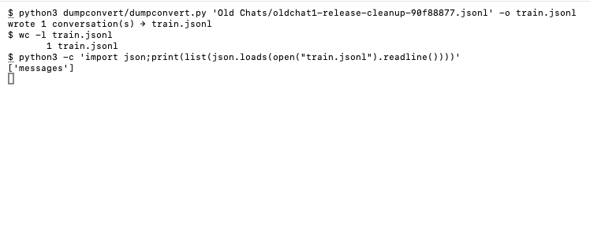
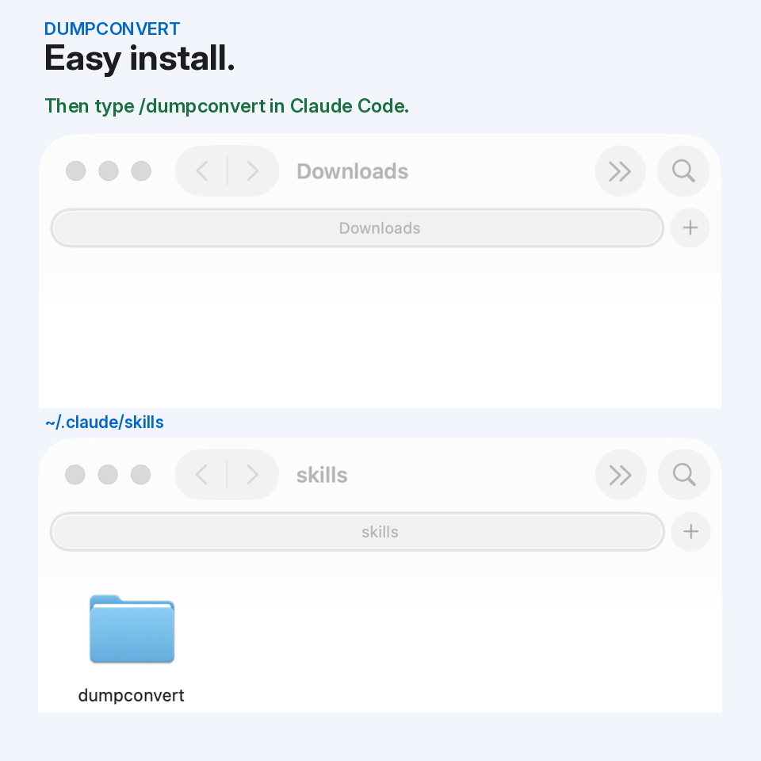

# dumpconvert

dumpconvert turns your saved AI coding chats into a training dataset.

Works with Unsloth, Soup, etc.



## Easy install

For example, Claude Code:

Drag this repo into ~/.claude/skills



Can't see `.claude`? Press Cmd+Shift+. in Finder.

## Use

```text
/dumpconvert all
/dumpconvert mylabel
```

Needs Python 3. Nothing else to install.

## Also see

[dumpboth](https://github.com/towelWet/dumpboth) saves your AI coding chat as `.md` + `.jsonl`.

[DBV](https://github.com/towelWet/dbv), a Mac chat viewer for saved Claude chats.
